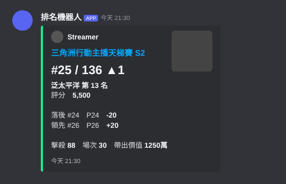

# Delta Force Streamer Ladder S2 — Discord Rank Message

[English](#english) | [繁體中文](#繁體中文)

---

## English

Keeps **one message** in a Discord channel that always shows a streamer's current position on the
**Delta Force Streamer Ladder S2**: rank, regional rank, rating, the point gap to the players above and below,
kills, matches, and extracted value. It's the same content as the OBS overlay.

It edits the same message every time, so the channel never gets spammed. GitHub Actions runs it for free
about every 5 minutes, so your computer doesn't need to be on.

> Looking for the OBS / Streamlabs overlay? → [deltaforce-ladder-overlay](https://github.com/derder2000/deltaforce-ladder-overlay)

*Illustration. Colors and text follow the overlay: Delta Force green, gold / silver / bronze for the top 3.*

### Features

- Edits one message in place. No spam
- Same 16 languages as the overlay
- **One place to maintain**: translations, region names and the ranking API settings are all read straight from the
  overlay project's `overlay.html`. Update the overlay and this updater follows automatically on its next run
- ▲ / ▼ shows the most recent rank change
- Shows each viewer's local time for "last updated"
- Runs on GitHub Actions for free. No server and no computer left on

### Setup

1. **Use this repository**: click **Fork** at the top right of this page to copy it to your own account.
   Scheduled runs are disabled on forks by default: open the **Actions** tab of your fork and enable workflows.
2. **Create a webhook in Discord**: channel settings → **Integrations** → **Webhooks** → **New Webhook** →
   **Copy Webhook URL**. Treat this URL like a password: anyone who has it can post in that channel.
3. **Add the settings**: your repository → **Settings** → **Secrets and variables** → **Actions**
   - **Secrets** tab → **New repository secret**: `DISCORD_WEBHOOK_URL` (the URL you copied) and `PLAYER` (the streamer's nickname)
   - **Variables** tab (optional): `LANGUAGE`, e.g. `en` (default `zh-TW`)
4. **Create the message**: **Actions** tab → **Discord rank** → **Run workflow**. When it finishes, open the run's
   log and copy the message ID it prints.
5. **Save the message ID**: **Variables** tab → **New repository variable** → `DISCORD_MESSAGE_ID` = the ID you copied.

From now on the message updates itself about every 5 minutes (GitHub may delay runs at busy times).

### Settings

| Name | Where | Required | Description |
|---|---|---|---|
| `DISCORD_WEBHOOK_URL` | Secret | Yes | Discord channel webhook URL |
| `PLAYER` | Secret | Yes | Streamer nickname (case-insensitive) or player ID |
| `LANGUAGE` | Variable | No | Display language, default `zh-TW`. Same codes as the overlay (`en`, `ja`, `ko`, …) |
| `DISCORD_MESSAGE_ID` | Variable | After step 4 | The message to keep editing |

### Good to know

- **Privacy**: secrets are encrypted, so the webhook URL and the streamer's name never appear in the repository.
  Action logs of a public repository are public, so the updater only logs a status line: never the name, rank or score.
- **No spam**: scheduled runs never post a new message. Only a manual run creates one, and only when no message ID is set.
- **Temporary problems**: if the official server or the translation file doesn't respond, the message is left as it is
  and the next run tries again. These count as warnings, not failures, so GitHub won't email you every 5 minutes.
- **Failure emails?** If `overlay.html` in the overlay project changes in a way this updater can't read, runs fail and
  GitHub emails you, because it won't fix itself. The channel message is left untouched until it's fixed.
- **Deleted the message?** Run the workflow manually once, then replace `DISCORD_MESSAGE_ID` with the new ID.
- **Inactive repositories**: GitHub pauses scheduled workflows in public repositories after 60 days without any commits.
  The ladder ends on January 10, 2027, so this normally doesn't matter.

### Run it on your own computer instead

1. Install [Node.js](https://nodejs.org/) 20 or newer
2. Copy `.env.example` to `.env` and fill it in (`.env` is git-ignored)
3. Run `node --env-file=.env update.mjs`. The first run creates the message and remembers its ID in `.message-id`
4. Use Windows Task Scheduler (or cron) to run it every few minutes

### Disclaimer

**Security note:** keep your webhook URL private. If it leaks, delete the webhook in Discord and create a new one.

This is an unofficial fan-made tool. It is not affiliated with Delta Force or its developers or publishers.
Ranking data comes from an endpoint the official event page uses publicly, which may change at any time
and break this tool. Please don't make it run more often than every 5 minutes.

### License

[MIT](LICENSE) © 2026 derder2000. You're free to use, modify, and share it; just keep the copyright notice.

---

## 繁體中文

在 Discord 頻道裡放**一則訊息**，固定顯示實況主在 **三角洲行動主播天梯賽 S2** 的即時排名：
名次、地區排名、評分、和前後名的差距、擊殺、場次、帶出價值，內容跟 OBS overlay 一樣。

每次都是編輯同一則訊息，不會洗版。由 GitHub Actions 免費大約每 5 分鐘自動執行，電腦不用開著。

> 要找 OBS / Streamlabs 的 overlay？→ [deltaforce-ladder-overlay](https://github.com/derder2000/deltaforce-ladder-overlay)

*示意圖。顏色和文字跟 overlay 一樣：Delta Force 官方綠，前三名是金 / 銀 / 銅。*

### 功能

- 只編輯同一則訊息，不洗版
- 跟 overlay 一樣支援 16 種語言
- **只要維護一個地方**：翻譯、地區名稱、排名 API 的網址和參數，全部直接讀 overlay 專案的 `overlay.html`。
  更新 overlay 之後，這邊下一次執行就會自動跟上
- ▲ / ▼ 顯示最近一次的名次變動
- 「最後更新時間」會自動用每個人自己的時區顯示
- 用 GitHub Actions 免費執行，不需要伺服器，電腦也不用開著

### 設定步驟

1. **複製這個專案**：按本頁右上角的「**Fork**」，複製一份到你自己的帳號。
   Fork 出來的專案預設會停用定時執行：打開你那份專案的「**Actions**」分頁，啟用 workflows。
2. **在 Discord 建立 Webhook**：頻道設定 →「**整合**」→「**Webhook**」→「**新 Webhook**」→「**複製 Webhook 網址**」。
   這個網址要當成密碼保管：拿到的人就能在那個頻道發任何訊息。
3. **加入設定**：你的專案 →「**Settings**」→「**Secrets and variables**」→「**Actions**」
   - 「**Secrets**」分頁 →「**New repository secret**」：新增 `DISCORD_WEBHOOK_URL`（剛剛複製的網址）和 `PLAYER`（實況主暱稱）
   - 「**Variables**」分頁（選填）：`LANGUAGE`，例如 `en`（預設 `zh-TW`）
4. **建立訊息**：「**Actions**」分頁 →「**Discord rank**」→「**Run workflow**」。跑完後點進那次執行的紀錄，複製裡面印出的訊息 ID。
5. **存下訊息 ID**：「**Variables**」分頁 →「**New repository variable**」→ `DISCORD_MESSAGE_ID` = 剛剛複製的 ID。

完成。之後訊息大約每 5 分鐘自動更新一次（GitHub 忙碌時可能會延遲）。

### 設定項目

| 名稱 | 放在哪裡 | 必填 | 說明 |
|---|---|---|---|
| `DISCORD_WEBHOOK_URL` | Secret | 是 | Discord 頻道的 Webhook 網址 |
| `PLAYER` | Secret | 是 | 實況主暱稱（大小寫不拘）或玩家 ID |
| `LANGUAGE` | Variable | 否 | 顯示語言，預設 `zh-TW`，代碼跟 overlay 相同（`en`、`ja`、`ko`…） |
| `DISCORD_MESSAGE_ID` | Variable | 第 4 步之後 | 要持續編輯的那則訊息 |

### 小提醒

- **隱私**：Secrets 是加密保存的，Webhook 網址和實況主名字都不會出現在專案裡。
  公開專案的 Actions 紀錄任何人都看得到，所以程式只會印出狀態，不會印出名字、名次或分數。
- **不會洗版**：定時執行永遠不會發新訊息，只有手動執行、而且還沒設定訊息 ID 時才會建立一則。
- **暫時性問題**：官方伺服器或翻譯檔沒回應時，頻道訊息會維持原樣，下次自動再試。
  這種情況只算警告、不算失敗，GitHub 不會每 5 分鐘寄信給你。
- **收到失敗通知信？** 代表 overlay 專案的 `overlay.html` 改成了這支程式讀不懂的格式。這種問題不會自己好，
  所以會算失敗並寄信通知你；修好之前，頻道訊息會維持原樣。
- **訊息被刪掉了？** 手動執行一次，再把 `DISCORD_MESSAGE_ID` 換成新的 ID。
- **專案太久沒動**：公開專案超過 60 天沒有任何 commit，GitHub 會暫停定時執行。
  天梯賽在 2027 年 1 月 10 日結束，通常不會遇到。

### 改在自己電腦上執行

1. 安裝 [Node.js](https://nodejs.org/) 20 以上
2. 把 `.env.example` 複製成 `.env` 並填好（`.env` 已經被 .gitignore 排除）
3. 執行 `node --env-file=.env update.mjs`。第一次執行會建立訊息，並把訊息 ID 記在 `.message-id`
4. 用 Windows 工作排程器（或 cron）每幾分鐘執行一次

### 聲明

**安全提醒：**Webhook 網址不要外流。萬一外流了，到 Discord 把那個 Webhook 刪掉再建一個新的。

本專案為粉絲自製的非官方工具，與 Delta Force 及其開發、營運商無任何關聯。
排名資料來自官方活動頁公開使用的介面，官方隨時可能變更，屆時本工具可能失效。
請不要把執行頻率設得比每 5 分鐘還短。

### 授權

[MIT](LICENSE) © 2026 derder2000。可以自由使用、修改、分享，只要保留原本的版權聲明即可。
